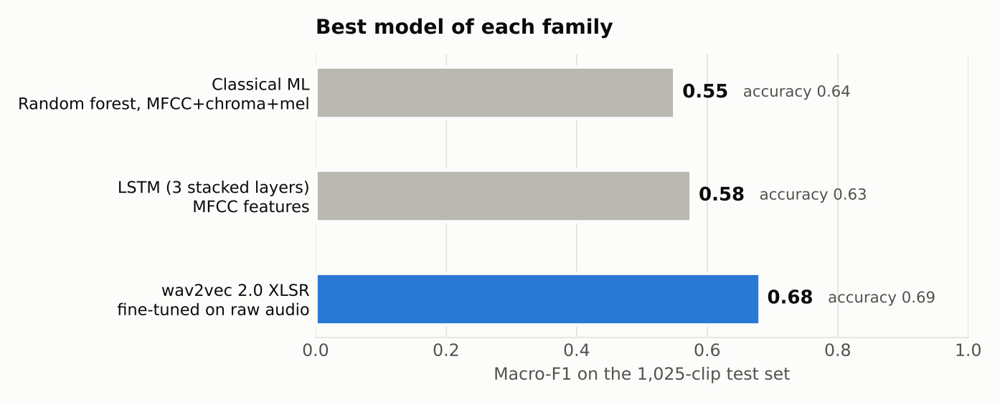
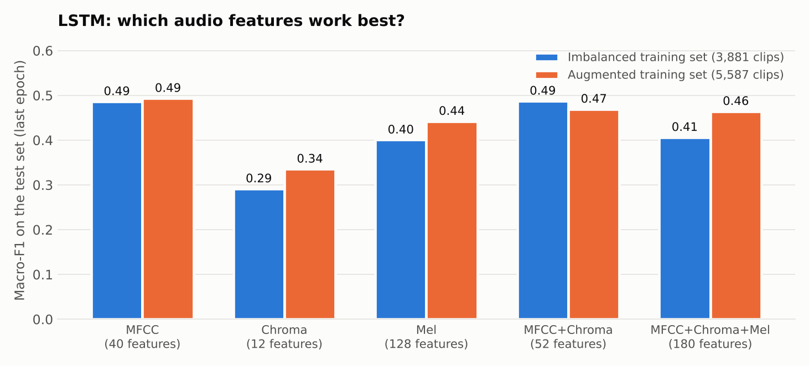
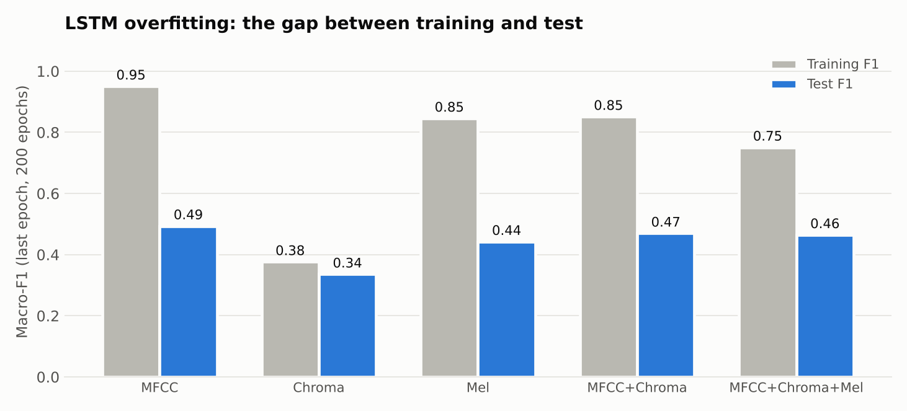

# Speech Emotion Recognition for Tunisian Dialect

End-of-study project (engineering diploma, 2022): a **speech emotion recognition (SER)** system for **Tunisian dialect**, designed to be integrated into **voicebots**. Given a short audio clip, the system predicts one of four emotions: `angry`, `happy`, `neutral`, `sad`.

The project builds the training data (a second corpus, annotation, augmentation) and compares three families of approaches on the same Tunisian-dialect test set:

1. **Classical machine learning** (SVM, decision tree, random forest) on hand-crafted acoustic features: MFCC, chroma, mel spectrogram
2. **Deep learning**: LSTM and bidirectional LSTM (BiLSTM) networks on the same features
3. **Fine-tuning of wav2vec 2.0 XLSR**, a self-supervised multilingual speech model, directly on the raw waveform

## Results

All models are evaluated on the same **1,025 test clips** (228 angry, 108 happy, 394 neutral, 295 sad). The classes are not balanced, so **macro-F1** (the average of the four per-class F1 scores) is the main metric here. A model that always answered `neutral` would reach 38% accuracy. The thesis tables report accuracy and **weighted-F1**, which is higher than macro-F1 because `happy`, the worst class, is also the smallest.



| Family | Best model | Features | Accuracy | Macro-F1 | Notebook |
|---|---|---|---|---|---|
| Classical ML | Random forest (100 trees) | MFCC + chroma + mel (180 values) | 0.64 | 0.55 | [02](notebooks/02_classical_ml_features.ipynb) |
| Deep learning | 3 stacked LSTM layers + batch norm | MFCC (40 values) | 0.63 | 0.58 | [03](notebooks/03_lstm_experiments.ipynb) |
| **Fine-tuned wav2vec 2.0 XLSR** | `wav2vec2-large-xlsr-53-arabic` + classification head | Raw waveform | **0.69** | **0.68** | [04](notebooks/04_wav2vec2_xlsr_finetuning.ipynb) |

Fine-tuning wav2vec 2.0 gives the best result by a clear margin (+0.10 macro-F1 over the best LSTM). The best model of each family was picked on the test clips, so these numbers are slightly optimistic (see [Limitations](#limitations)).

<details>
<summary><b>All models compared</b> (test set, 1,025 clips)</summary>

From the training logs kept in the notebooks (augmented training set, 5,587 clips):

| Model | Accuracy | Macro-F1 | Weighted-F1 |
|---|---|---|---|
| SVM, linear kernel | 0.57 | 0.51 | 0.56 |
| SVM, polynomial kernel | 0.56 | 0.48 | 0.54 |
| SVM, RBF kernel | 0.57 | 0.46 | 0.54 |
| Decision tree, depth 4 | 0.52 | 0.41 | 0.49 |
| Decision tree, depth 6 | 0.53 | 0.40 | 0.49 |
| Random forest, 20 trees | 0.61 | 0.56 | 0.61 |
| Random forest, 100 trees | 0.64 | 0.55 | 0.62 |
| LSTM (123 units), MFCC, 200 epochs | 0.54 | 0.49 | |
| LSTM (123 units), MFCC + chroma + mel, 200 epochs | 0.52 | 0.46 | |
| 3 stacked LSTM + batch norm, MFCC, 100 epochs | 0.63 | 0.58 | |
| BiLSTM, MFCC (surviving run, definition lost) | 0.59 | 0.51 | |
| **wav2vec 2.0 XLSR, fine-tuned, 4 epochs** | **0.69** | **0.68** | **0.69** |

**As reported in the thesis**, for each feature set (accuracy / F1 in %; F1 is the weighted F1 for the classical models, as reported for the deep-learning models):

| Model | MFCC | Chroma | Mel | MFCC + Chroma | MFCC + Mel | All three |
|---|---|---|---|---|---|---|
| SVM | 56 / 55 | 37 / 37 | 47 / 44 | 55 / 54 | 53 / 52 | 57 / 56 |
| Decision tree | 56 / 53 | 34 / 35 | 52 / 50 | 45 / 42 | 44 / 41 | 52 / 49 |
| Random forest | **64 / 63** | 35 / 36 | 61 / 59 | 63 / 62 | 54 / 53 | **64 / 62** |
| LSTM | 61.7 / 56.4 | 41.1 / 39.3 | 61.0 / 59.7 | 62.0 / 58.0 | not run | 57.0 / 50.5 |
| BiLSTM | 59.2 / 52.0 | 39.5 / 38.0 | 59.7 / 46.5 | 58.7 / 50.3 | not run | 57.2 / 49.8 |
| wav2vec 2.0 XLSR (raw audio) | 69 accuracy, 0.69 weighted-F1, 0.68 macro-F1 | | | | | |

The LSTM scores of the thesis come from other runs than the surviving logs and are higher for some feature sets (mel: 61% against 48% accuracy). Both are shown rather than hiding the difference.
</details>

### Classical machine learning

- **Random forests are the best classical models** (accuracy 0.64), clearly ahead of SVMs (0.57) and decision trees (0.53).
- **MFCC alone is as good as all the features together** for the random forest (accuracy 64%, F1 63%, against 64% and 62% with the 180 values). Chroma alone is the weakest feature (35% to 37%).
- **`happy` is the hard class** for every model (F1 between 0.00 and 0.29). It is the smallest class and is mostly confused with `neutral`.

### LSTM and BiLSTM



- **Chroma alone is the weakest feature set** for the LSTM in every run. MFCC, mel and MFCC + chroma are within a few points of each other, and their order depends on the run (in the surviving logs MFCC is the best with macro-F1 0.49; in the thesis tables MFCC + chroma reaches F1 58%).
- **The unidirectional LSTM beats the BiLSTM** in almost every case (best accuracy 62% against 60%).
- **Augmentation helps the weak feature sets** (+0.04 to +0.06 macro-F1 for chroma, mel and the full 180 values) but makes no real difference for MFCC.
- **The networks overfit heavily**: with MFCC the training F1 reaches 0.95 while the test F1 stays at 0.49.



- A deeper network (three stacked LSTM layers with batch normalisation and recurrent dropout) trained for 100 epochs is the best LSTM (accuracy 0.63, macro-F1 0.58), and shorter training beats 200 epochs.

### wav2vec 2.0 XLSR

| Metric | Value |
|---|---|
| Accuracy | **69%** |
| Macro F1-score | **0.68** |
| Weighted F1-score | 0.69 |

| Emotion | Precision | Recall | F1-score | Test clips |
|---|---|---|---|---|
| angry | 0.56 | 0.84 | 0.67 | 228 |
| happy | 0.60 | 0.62 | 0.61 | 108 |
| neutral | 0.79 | 0.54 | 0.64 | 394 |
| sad | 0.78 | 0.81 | 0.79 | 295 |


- `sad` is the easiest emotion (F1 0.79). `happy`, the smallest class, is much better recognised than by the classical models (F1 0.61 against 0.00 to 0.29).
- The model over-predicts `angry` (recall 0.84, precision 0.56) and misses many `neutral` clips (recall 0.54).
- One epoch already reaches a recall of 76% for `angry` and 75% for `sad`, against 57% and 74% for the best random forest; four epochs improve every class except `neutral` (recall 58% then 54%).
- The training loss falls from 0.81 to 0.27 while the validation loss stays around 0.95: the model starts to overfit, although validation accuracy still improves from 61% to 70%.


## Data

The audio is **not included** in this repository: the first dataset belongs to the company where the internship took place, and the second one is made of audio from TV channels and YouTube channels, which are not mine to redistribute.

**1. Existing dataset of the host company.** 6,903 segments of acted and semi-spontaneous Tunisian speech, from male and female speakers. Each segment contains one speaker and one scene, and was annotated with an emotion by the company's annotators (four main emotions, plus a few `fear`, `disgust` and `surprise`). I cleaned the annotation file (duplicates, missing and null labels, invalid values). It also marks 2,039 bad-quality segments and a few `fear`, `disgust` and `surprise` segments, which I left out. **I kept the 4,910 segments with one of the four main emotions**: 1,860 `neutral`, 1,443 `sad`, 1,051 `angry` and 556 `happy`.

**2. A second corpus that I built.** To add data for the minority classes, I collected **12 videos** from Tunisian TV channels (series, talk shows, comedy and debate programmes) and from YouTubers (podcasts and blogs), about **5 hours** in total. The videos were converted to 16 kHz mono WAV with FFmpeg and cut at silences into **2,429 segments**. I was the only annotator, and every segment was annotated and then checked a second time. The `angry` (295), `happy` (260) and `sad` (126) segments were added to the training set; the 528 `neutral` segments were not needed.

**3. Data augmentation.** The `angry` and `happy` clips of the training set were augmented with three transformations: **white noise**, **time stretching** and **pitch shifting** ([notebook 01](notebooks/01_data_augmentation.ipynb)).

**Train and test sets.** The 80/20 split was made with the `split-folders` package on the company data, folder by folder (151 recordings). The extra clips and the augmented copies went into the **training set only**; the test set contains neither.

| | angry | happy | neutral | sad | Total |
|---|---|---|---|---|---|
| Training set (original: 3,881 clips; after extra and augmented clips) | 1,494 | 1,347 | 1,465 | 1,281 | 5,587 |
| Test set | 228 | 108 | 394 | 295 | 1,025 |

The training set is balanced; the test set keeps its natural, unbalanced distribution and is the same in every experiment, so all models are directly comparable.

## Notebooks

| Notebook | Content |
|---|---|
| [`01_data_augmentation.ipynb`](notebooks/01_data_augmentation.ipynb) | Preparing the audio, the three augmentation functions, augmenting a training folder (safeguard against augmenting the test set) |
| [`02_classical_ml_features.ipynb`](notebooks/02_classical_ml_features.ipynb) | Feature extraction (MFCC, chroma, mel), SVM / decision tree / random forest, per-class results |
| [`03_lstm_experiments.ipynb`](notebooks/03_lstm_experiments.ipynb) | LSTM on each feature set, imbalanced vs augmented training, deeper architecture, BiLSTM |
| [`04_wav2vec2_xlsr_finetuning.ipynb`](notebooks/04_wav2vec2_xlsr_finetuning.ipynb) | Fine-tuning of wav2vec 2.0 XLSR for 4-class emotion recognition |

The stored outputs (training logs, classification reports) are those of the **original runs on Google Colab**. The code was cleaned and documented afterwards, but could not be re-run on the original audio. Notebooks 01, 02 and 03 were run on synthetic audio to check that the code works; notebook 04 needs a GPU and was not re-run. Two parts are **not original code**: the augmentation parameters (they were not recorded) and the BiLSTM cell (rebuilt from the architecture diagram of the thesis); both are marked in the notebooks.

## Repository structure

```
.
├── README.md
├── requirements.txt
├── .gitignore
├── notebooks/
│   ├── 01_data_augmentation.ipynb
│   ├── 02_classical_ml_features.ipynb
│   ├── 03_lstm_experiments.ipynb
│   └── 04_wav2vec2_xlsr_finetuning.ipynb
└── results/                    # figures used in this README
```

## How to run

Prepare your own dataset in the layout below (the audio is not in the repository).

**Notebooks 01 to 03** (augmentation, classical ML and LSTM):

```
data/
├── annotations.xlsx             # columns: path (e.g. 15-3.wav), label (angry / happy / neutral / sad)
├── train/<recording>/<recording>-<n>.wav
└── val/<recording>/<recording>-<n>.wav     # used as the test set
```

Edit the configuration cell (`DATA_DIR`, `FEATURES`) and run all cells. Notebook 01 runs without data (synthetic demonstration). The LSTM notebook needs TensorFlow 2.16 or later.

**Notebook 04** (wav2vec 2.0), on Google Colab with a GPU runtime:

1. Prepare two tab-separated files, `train.csv` and `test.csv`, with the columns `name`, `path`, `emotion`.
2. Edit the paths in the configuration cell and run all cells.

Install the dependencies with `pip install -r requirements.txt`.

## Limitations

These points matter when reading the numbers above.

- **Clips from the same recording can be in both the training and the test set.** The split was made per recording folder, clip by clip, not by speaker or recording. A model can therefore partly learn a speaker's voice or the recording conditions, and the test scores are probably higher than what new speakers would get. A split by recording is the first thing to do for a more reliable estimate.
- **The test set was also used for model selection.** It served as the validation set during training and to pick hyperparameters (number of trees, tree depth, epochs, best architecture). The final scores are slightly optimistic. A separate held-out set is needed for a clean final number.
- **One run per model, no cross-validation, no confidence intervals.** Differences of a few points between models (for example the classical models against the LSTM) are within what a different random seed could change.
- **Mixed training data, single-source test data.** The training set mixes company data, YouTube audio and augmented copies, while the test set only has company data. How well the models transfer to the YouTube audio, or to other sources, has not been measured.
- **Acted and TV speech, not phone calls.** Recordings from series, talk shows and a company dataset are not voicebot audio. Phone-quality recordings and unseen speakers have not been evaluated.
- **The LSTM does not read the audio as a time series.** Each clip is first averaged into one vector of features, and the LSTM reads this vector as a sequence of 40 values (MFCC). The recurrence runs over the feature dimension, not over time. Feeding frame-level features is the natural next step.
- **Mean pooling in the wav2vec 2.0 model also averages padded frames.** Mask-aware pooling would be more accurate for clips of different lengths.
- **Some original material was lost.** The augmentation parameters, the original BiLSTM code and some feature-by-feature runs were not recovered (see the notes in the notebooks). No convolutional network was trained: the thesis lists CNNs on spectrograms as future work.

## Next steps

- Re-evaluate all models with a split by recording (or speaker), then with cross-validation over recordings, and report mean and spread.
- Measure transfer: test on held-out YouTube clips, including `neutral`, and on telephone-quality audio from a real voicebot.
- Add a confusion matrix and error analysis for wav2vec 2.0 (`neutral` against `angry`).
- Class-weighted loss, early stopping and stronger regularisation to reduce overfitting.
- Frame-level features with an LSTM or a CNN on spectrograms, as a comparison with fine-tuning.

## Credits

- Thesis: W. Zoghbi, *Implementation of Speech Emotion Recognition System for Tunisian Arabic Dialect*, graduation project, Engineering School of Statistics and Information Analysis (ESSAI), University of Carthage, 2022. The three augmentation functions and the BiLSTM architecture come from it.
- The wav2vec 2.0 model code and training loop are adapted from the Greek speech emotion recognition notebook of [m3hrdadfi/soxan](https://github.com/m3hrdadfi/soxan).
- The hand-crafted feature extraction follows the approach of [x4nth055/emotion-recognition-using-speech](https://github.com/x4nth055/emotion-recognition-using-speech).
- Pretrained model: [jonatasgrosman/wav2vec2-large-xlsr-53-arabic](https://huggingface.co/jonatasgrosman/wav2vec2-large-xlsr-53-arabic), built on [wav2vec 2.0 / XLSR-53](https://arxiv.org/abs/2006.13979).

## Author

**Wissal Zoghbi** · [GitHub](https://github.com/wissalzoghbi)
