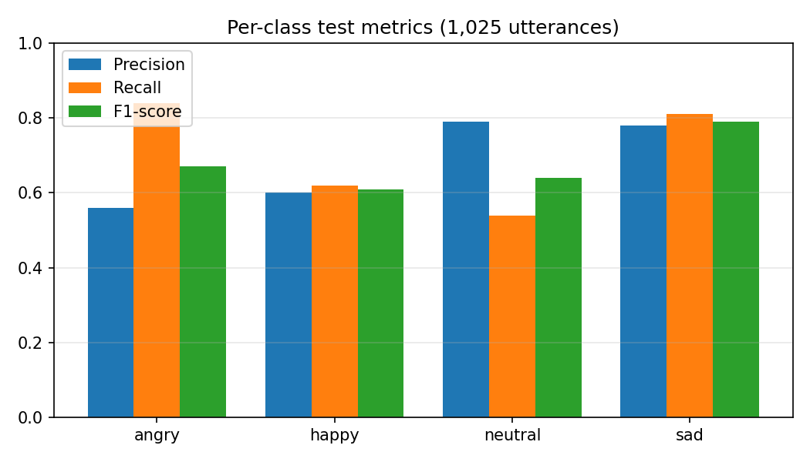
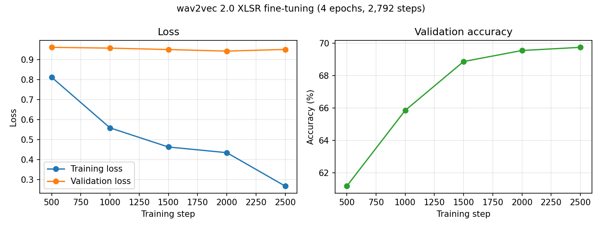

# Speech Emotion Recognition for Tunisian Dialect

End-of-study project: a **speech emotion recognition (SER)** system for **Tunisian dialect**, designed to be integrated into **voicebots**. Given a short audio clip, the system predicts one of four emotions: `angry`, `happy`, `neutral`, `sad`.

The project compares three families of approaches on a Tunisian-dialect speech corpus that I built and annotated myself:

1. **Classical machine learning** on hand-crafted acoustic features (MFCC and others)
2. **Deep learning** (CNN, LSTM, BiLSTM)
3. **Fine-tuning of wav2vec 2.0 XLSR**, a self-supervised multilingual speech model

## Results (wav2vec 2.0 XLSR)

Evaluated on 1,025 held-out utterances:

| Metric | Value |
|---|---|
| Accuracy | **69%** |
| Macro F1-score | **0.68** |
| Weighted F1-score | 0.69 |

| Emotion | Precision | Recall | F1-score | Test utterances |
|---|---|---|---|---|
| angry | 0.56 | 0.84 | 0.67 | 228 |
| happy | 0.60 | 0.62 | 0.61 | 108 |
| neutral | 0.79 | 0.54 | 0.64 | 394 |
| sad | 0.78 | 0.81 | 0.79 | 295 |



**What the numbers say**

- `sad` is the easiest emotion to recognise (F1 0.79). `happy` is the hardest (F1 0.61) and is also the smallest class.
- The model over-predicts `angry` (recall 0.84 but precision 0.56) and misses many `neutral` utterances (recall 0.54).
- The training loss falls from 0.81 to 0.27 while the validation loss stays around 0.95: the model starts to overfit, even though validation accuracy still improves from 61% to 70%.



> TODO: add the comparison with the classical ML and deep learning models once their notebooks are added (table below).

| Approach | Features / model | Accuracy | Macro F1 |
|---|---|---|---|
| Classical ML | MFCC and other features | to be added | to be added |
| Deep learning | CNN / LSTM / BiLSTM | to be added | to be added |
| **wav2vec 2.0 XLSR (fine-tuned)** | Raw waveform | **69%** | **0.68** |

## Project pipeline

| Step | Content | Notebook |
|---|---|---|
| 1. Corpus | Speech corpus in Tunisian dialect, manual emotion annotation, state of the art, data exploration and visualisation, handling of class imbalance with data augmentation | to be added |
| 2. Classical ML | Feature extraction (MFCC etc.) and comparison of classifiers | to be added |
| 3. Deep learning | CNN, LSTM and BiLSTM models and comparison | to be added |
| 4. wav2vec 2.0 XLSR | Fine-tuning for 4-class emotion recognition | [`notebooks/04_wav2vec2_xlsr_finetuning.ipynb`](notebooks/04_wav2vec2_xlsr_finetuning.ipynb) |

> TODO: describe the corpus here (number of speakers, total duration, recording conditions, how the emotions were elicited or annotated, class distribution before and after augmentation, and whether augmentation was applied to the training split only).

## wav2vec 2.0 XLSR fine-tuning

- **Base model:** [`jonatasgrosman/wav2vec2-large-xlsr-53-arabic`](https://huggingface.co/jonatasgrosman/wav2vec2-large-xlsr-53-arabic) (XLSR-53, already fine-tuned on Arabic speech)
- **Architecture:** wav2vec 2.0 encoder, mean pooling over time, then a classification head (dropout, dense, tanh, dropout, 4-way output)
- **Frozen:** the convolutional feature extractor. The transformer layers and the head are trained.
- **Data:** 5,587 training utterances and 1,025 test utterances, audio resampled to 16 kHz
- **Training:** 4 epochs (2,792 optimisation steps), effective batch size 8, learning rate 1e-4, cross-entropy loss, about 97 minutes on a Colab GPU

## Repository structure

```
.
├── README.md
├── requirements.txt
├── notebooks/
│   └── 04_wav2vec2_xlsr_finetuning.ipynb
└── results/
    ├── wav2vec2_training_curves.png
    └── wav2vec2_per_class_metrics.png
```

## How to run

The audio corpus is **not included** in this repository. To retrain the model you need your own dataset in the same format:

1. Two tab-separated files, `train.csv` and `test.csv`, with the columns `name`, `path`, `emotion`.
2. Open `notebooks/04_wav2vec2_xlsr_finetuning.ipynb` in Google Colab with a GPU runtime.
3. Edit the paths in the configuration cell and run all cells.

## Limitations and next steps

- The test split was also used as the validation split during training. A separate held-out test set would give a cleaner final estimate.
- The mean pooling averages over padded frames as well. Mask-aware pooling would be more accurate for clips of different lengths.
- Add a confusion matrix to see which emotions are confused with each other (for example `neutral` vs `angry`).
- Try class-weighted loss, early stopping or stronger regularisation to reduce overfitting, and report results over several runs.
- Test generalisation on new speakers and on real voicebot audio (phone-quality recordings).

## Credits

- The model code and training loop are adapted from the Greek speech emotion recognition notebook of [m3hrdadfi/soxan](https://github.com/m3hrdadfi/soxan).
- Pretrained model: [jonatasgrosman/wav2vec2-large-xlsr-53-arabic](https://huggingface.co/jonatasgrosman/wav2vec2-large-xlsr-53-arabic), built on [wav2vec 2.0 / XLSR-53](https://arxiv.org/abs/2006.13979).

## Author

**Wissal Zoghbi**, Data Science and AI engineer
[LinkedIn](https://www.linkedin.com/in/wissal-zoghbi) · [GitHub](https://github.com/wissalzoghbi)
